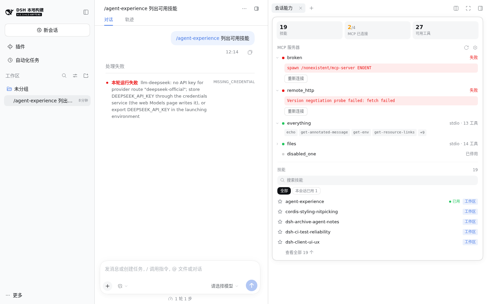
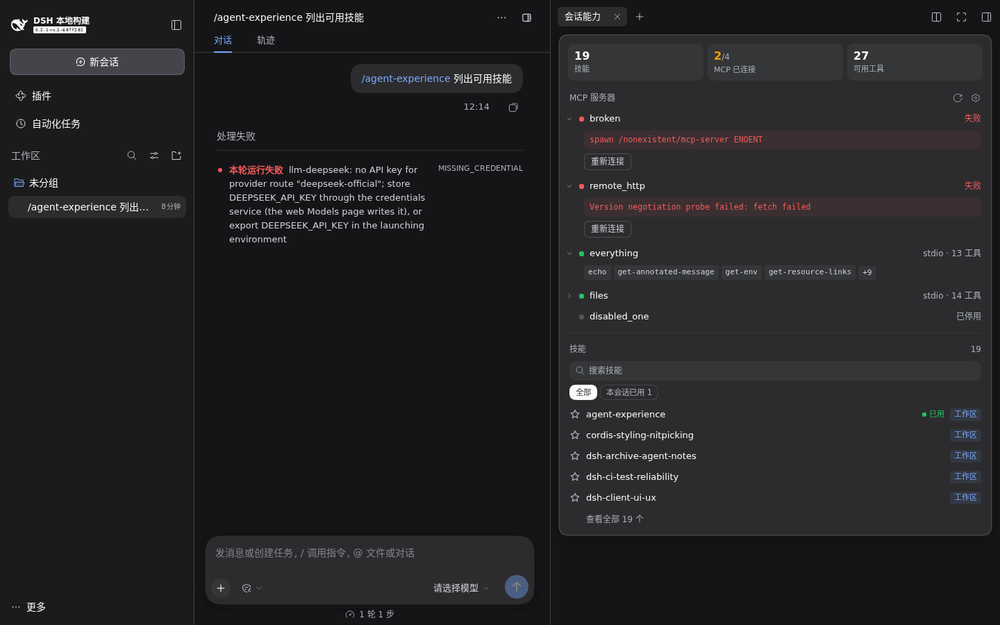

# dsh-plugin-session-capabilities

[English](./README.md)

适用于 [DeepSeek Harness](https://github.com/deepseek-ai/deepseek-harness)（dsh）Web / 桌面端的插件：
一张停靠式的**会话能力卡片**，展示当前会话加载的技能与 MCP 服务器。点击会话标题栏右上角的图标即可打开（新建的空白会话也有），
卡片以面板形式停靠在对话区右侧、标题栏下方，对话内容随之收窄重排，不占用右侧边栏。




## 功能

- **概览**：技能数量、MCP 已连接 / 启用数、可用 MCP 工具数。
- **MCP 服务器**：状态点（已连接 / 连接中 / 失败 / 已停用）、传输方式与工具数、可展开的工具列表、
  当前会话的“已用”标记，悬停或展开显示调用次数（含失败调用），
  失败原因，以及一键**重新连接**（重新加载对应的 mcp-client 实例）。区块标题处有刷新和设置按钮（设置打开插件页）。
- **技能**：可搜索列表，按来源筛选（工作区 / 用户 / 插件 / 内置），“本会话已用”筛选与标记，悬停显示描述。
- 实时更新：Host 通过长轮询推送目录变化，每轮对话结束后刷新使用情况。

除“重新连接”外全部只读。端点只显示命令名或 HTTP origin，不会显示参数、环境变量、请求头或查询串。

## 安装

包内已带预构建的 `lib/`，可直接从目录或 git 仓库安装：

```sh
# 本地目录
dsh plugin --profile web add link:/绝对路径/dsh-plugin-session-capabilities

# GitHub（发布后）
dsh plugin --profile web add github:kurerere/dsh-plugin-session-capabilities
```

之后照常运行 `dsh --profile web`。确认插件层已加载：

```sh
dsh --profile web --dump-config | grep -A2 'dsh-plugin-session-capabilities'
```

卸载：`dsh plugin --profile web remove dsh-plugin-session-capabilities`。

## 开发

```sh
pnpm install
node scripts/link-dsh-checkout.mjs /path/to/deepseek-harness   # 可选：对照本地 checkout 做类型检查
pnpm run check        # 类型检查 + 构建 lib/ + 校验产物
pnpm run types        # 生成 lib/types
```

不安装、直接在 deepseek-harness checkout 中运行：把 `dev/cordis.dev.yml.example` 复制为
`dev/cordis.dev.yml` 并填入绝对路径，然后：

```sh
cd /path/to/deepseek-harness
pnpm dsh --profile web --patch /abs/path/dsh-plugin-session-capabilities/dev/cordis.dev.yml --no-open
```

请使用显式的 `--profile web --patch …` 写法；`pnpm dsh web --patch …` 简写在部分环境下会失败，未作为测试形式。

截图由 `scripts/e2e-screenshot.mjs` 对已运行的服务和已有会话生成（无需 API Key），用法见脚本头部注释。

## 兼容性

| | |
|---|---|
| 测试版本 | dsh **0.2.1-rc.2**（`687f282`），web profile，Chromium |
| 声明范围 | `engines.dsh: >=0.2.1-rc.2 <0.3.0` |
| 客户端 | 仅 Web / 桌面端（无 TUI 视图） |

## 已知限制

- 面板宽度固定（360 px，最多占对话区 45%），不可拖动调整。
- 标题栏右上角只容纳一个控件，原本是右侧边栏的展开按钮。插件接管了该位置，渲染自己的开关和一个等效的展开按钮；该按钮的提示里不再显示快捷键。
- dsh 没有 MCP 状态服务：状态由 mcp-client 实例、其配置、会话工具列表和 mcp-client 日志拼合而成；
  若 mcp-client 日志措辞变化，失败详情会退化为仅依据实例状态。
- “重新连接”通过重新加载 mcp-client 插件实例实现（mcp-client 没有重连接口）。
- 设置按钮打开插件页，没有独立的 MCP 设置页。
- 技能行的星标仅为装饰（暂无收藏功能）。
- 技能使用次数只统计当前会话日志（不含子代理会话）。

设计说明见 [notes/design.md](notes/design.md)。

## 许可

[MIT](./LICENSE) © yy wan
